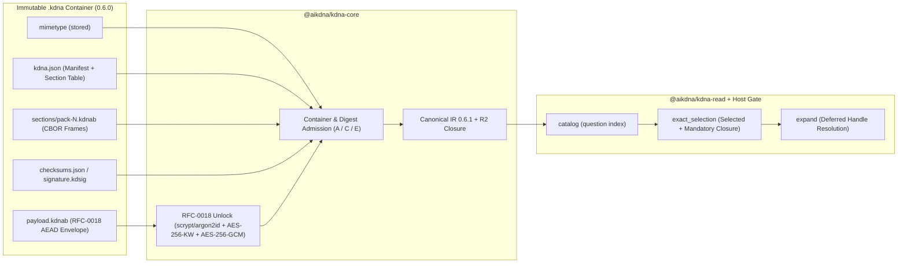

# KDNA Core Specification

KDNA (`.kdna`) is an open, portable file format for expressible human thinking, judgment, trade-offs, boundaries, and taste. This document summarizes the active **Container `0.6.0`** and **R2** semantic line.

Normative machine-readable definitions live in [`specs/public-semantic-source.json`](specs/public-semantic-source.json), JSON Schemas live in [`specs/`](specs/) and [`schema/`](schema/), and the full specification map is indexed in [`SPEC-INDEX.md`](SPEC-INDEX.md#kdna-public-specification-index). Reference implementations live in [`@aikdna/kdna-core`](packages/kdna-core/) and [`@aikdna/kdna-read`](packages/kdna-read/).

---

## 1. Architecture Overview (Container `0.6.0` & R2)

| Layer | Current Coordinate | Role |
| --- | --- | --- |
| **Distribution Container** | `format_version: "0.6.0"` (public section packs) / `ProtectedManifest06Candidate` (encrypted `payload.kdnab`) | Immutable `.kdna` ZIP archive (`mimetype` stored uncompressed at offset `0`, `kdna.json`, stored `sections/pack-N.kdnab` CBOR frames or encrypted `payload.kdnab`, `checksums.json`, optional `signature.kdsig` & `attachments/`) |
| **Judgment Payload** | `kdna.payload.judgment` `0.5.1` (`kdna.r2-semantics/1`) | Scoped judgments (`focus`, `core_expression`, `method` with language-neutral ASCII `method_roles`, `boundaries`, `exceptions`, `misuse`, `reasons`, `materials`, `shared_declarations`, `sources`, `relationships`) |
| **Canonical IR** | `kdna.canonical-ir/0.6.1` | Deterministic typed node graph (`asset_index`, `catalog`, `mandatory_closures`, `expansion_targets`, RFC 8785 JCS SHA-256 `ir_digest`) |
| **Selective Read Protocol** | `kdna.read/0.7.0-candidate` (native sections) / `kdna.read/0.6.4` (base) | Progressive disclosure (`catalog` → `exact_selection` with mandatory `support`/`qualify`/`conflict` closure → `expand` handles) under explicit Host permission and byte budgets |
| **Local Password Encryption** | `kdna.encryption.password` / `kdna.envelope.aead` ([`RFC-0018`](rfcs/RFC-0018-envelope-aead.md)) | Account-free offline protection: `scrypt-sha256` or `argon2id` KDF → `AES-256-KW` CEK wrapping → `AES-256-GCM` AEAD payload encryption bound to manifest AAD |
| **Optional Offline Signature** | `kdsig.ed25519` ([`RFC-0021`](rfcs/RFC-0021-signature-track.md)) | Optional Ed25519 signature bundle (`signature.kdsig`), verified offline and fail-closed when present |



---

## 2. Distribution Container (`0.6.0`)

A `.kdna` work is one immutable ZIP archive whose first entry MUST be `mimetype`, stored without compression (method `0`) at offset `0`, containing the exact UTF-8 bytes:

```text
application/vnd.kdna.asset
```

### Standard Entries

| Entry | Role |
| --- | --- |
| `mimetype` | Unambiguous format identification (`application/vnd.kdna.asset`) |
| `kdna.json` | Manifest: asset identity, versions, creator/license metadata, compatibility tuple, section layout/tables (public `0.6.0`) or protection envelope metadata (encrypted `0.6.0`) |
| `sections/pack-N.kdnab` | CBOR-framed section packs storing structured judgments, materials, declarations, relationships, and precomputed indices (unencrypted `0.6.0`) |
| `payload.kdnab` | Encrypted AEAD envelope (`RFC-0018`) for password-protected or licensed works |
| `checksums.json` | Per-entry SHA-256 integrity manifest and canonical runtime entry-set digest (**E**) |
| `signature.kdsig` | Optional Ed25519 signature bundle; if present, verification failure MUST reject the asset |
| `attachments/` | Optional supplementary files governed by manifest and loader policy |

Authoring drafts, build logs, credentials, and temporary plaintext MUST NOT appear in a distributed `.kdna` archive. Container admission explicitly rejects path traversal as well as `build-receipt.json`, `reports/*`, and `authoring/*`.

---

## 3. Judgment Payload (`kdna.payload.judgment/0.5.1`)

The payload encodes one bounded judgment system with explicit authorship, scope, and relationships:

- **Asset-level declarations**: `highest_question`, `scope`, `kernel` (`purpose`, `foundation_refs`), `shared_declarations` (`worldview`, `value_order`), asset-level `boundaries` (`limit`, `exclude`, `out_of_domain`), `attributions`, `sources`, and `history`.
- **Judgments**: Each judgment unit carries a stable `id`, `focus` (the concrete question it addresses), `scope`, `core_expression`, structured `method` (`components` with language-neutral ASCII `method_roles`), `reasons` (`support` / `calibration`), `materials` (premises, cases, source citations), `boundaries`, `exceptions`, `misuse` warnings, and `result`.
- **Typed relationships**: Explicit links between judgments using four core relationship kinds:
  - `support` (`supporter` → `claim`: supporting judgment required whenever `claim` is selected)
  - `qualify` (`qualifier` → `qualified`: qualifying judgment required whenever `qualified` is selected)
  - `conflict` (`side_a` ↔ `side_b`: undirected explicit tension required in both directions)
  - `complement` (`supplement` → `base`: related peer perspective kept optional in the catalog without expanding mandatory closure)

Loaders MUST preserve every selected field verbatim without silently trimming, reordering, or rewriting the author's claims, boundaries, or exceptions.

---

## 4. Integrity Digests & Verification

The specification distinguishes four separate SHA-256 digests (`@aikdna/kdna-core`):

| Symbol | Profile | Scope |
| --- | --- | --- |
| **A** | `kdna.digest-basis.container-bytes/0.2.0` | SHA-256 of the raw immutable `.kdna` ZIP archive bytes |
| **C** | `kdna.digest-basis.content-tree/0.2.0` | SHA-256 of the canonicalized container content tree (`KDNA-CONTENT-TREE\00.2.0\0` over UTF-8 sorted admitted container entries excluding `checksums.json` and `signature.kdsig`; `.json` entries serialized via RFC 8785 JCS with `kdna.json`'s `content_digest` and `authoring.content_digest` omitted; binary entries hashed verbatim) |
| **E** | `kdna.digest-basis.runtime-entry-set/0.3.0-candidate` (`0.6.0` sections) / `0.2.0` (`0.5.0` payload) | SHA-256 over the sorted runtime entry set (`kdna.json`, all `sections/*` packs [or `payload.kdnab` in `0.5.0`], and `manifest.runtime.mandatory_entries`, excluding `checksums.json`, `signature.kdsig`, and `mimetype`); recorded in `checksums.json` |
| **`ir_digest`** | `CanonicalIR:SHA-256(RFC8785)` | SHA-256 of the RFC 8785 JCS canonical serialization of the derived `CanonicalIR` (`kdna.canonical-ir/0.6.1`) |

Validation verifies container layout, manifest schema, payload/section structure, checksums (when present), optional signatures (when present), and compatibility coordinates. Passing format validation confirms byte integrity and schema conformance; evaluating whether a judgment fits a real-world situation always belongs to human reviewers and callers.

---

## 5. Selective Read Protocol (`catalog` → `exact_selection` → `expand`)

Compatible runtimes disclose judgment content progressively under explicit Host consent (`--allow-read`) and declared byte budgets (`budget_bytes`):

1. **`catalog`** (`status: "catalog_only"`): Returns `catalog` (judgment IDs, `focus` questions, `node_ref`, optional `lifecycle`) and `asset_index` without returning judgment bodies (`digests: null`).
2. **`exact_selection`**: Given `selection: { asset_id, asset_version, judgment_ids }`, returns the requested judgment bodies together with their deterministic **mandatory closure**:
   - applicable asset-level `shared_declarations`, `foundation`/`premise` materials, and global `boundaries`;
   - judgment-local `boundaries`, `exceptions` (including `replace_limit` replacements), `misuse` warnings, `lifecycle.superseded_by` replacements, and required `dependencies`;
   - supporting (`support`) and qualifying (`qualify`) judgments whenever the target (`claim` / `qualified`) judgment is selected;
   - both sides of any `conflict` relationship involving a selected judgment;
   - minted `expansion_handles` for deferred optional targets (such as `complement` peers or examples).
3. **`expand`**: Resolves a minted `expansion_handle` bound to the same `snapshot_id`, `host_id`, and `host_epoch` within its expiry window (`<= 3,600,000 ms`).
4. **`whole_asset`**: Admits and verifies the full container (`A`, `C`, `E`, `ir_digest`) and returns the asset overview, global declarations, and deferred `expansion_handles` (without dumping judgment bodies inline).

Reading a `.kdna` file delivers structured judgment text only. It never grants permission to write files, access networks, or trigger external actions.

---

## 6. Local Password Encryption (`RFC-0018`) & External Grants (`RFC-0019`)

Private `.kdna` works can be encrypted locally with a passphrase (`kdna protect`) without any online account or server (`kdna.envelope.aead`, `profile_version: "0.1.0"`):

- **KDF**: `scrypt-sha256` (mandatory baseline) or `argon2id` (optional profile)
- **Key Wrapping**: `AES-256-KW` (RFC 3394)
- **Payload AEAD**: `AES-256-GCM` bound to manifest Additional Authenticated Data (AAD)
- **Memory discipline**: Decrypted plaintext and content-encryption keys stay in volatile memory and MUST NOT be written to logs, caches, or temporary files.

Unknown crypto profiles, algorithms, AAD fields, or failed authentication tags MUST fail closed. See [`RFC-0018`](rfcs/RFC-0018-envelope-aead.md) and [`RFC-0019`](rfcs/RFC-0019-account-device-external-key-grant.md).

---

## 7. Conformance Suites

A conforming implementation MUST pass the repository's executable test and conformance suites without modifying committed vectors:

```bash
npm test
npm run conformance
npm run conformance:canonical
npm run conformance:envelope-aead
npm run conformance:runtime-contract
npm run audit:post-cutover
```

---

## 8. Historical Note (`0.1.0` & `0.5.0`)

Earlier `0.1.0` (`LoadPlan` / `Runtime Capsule` / CLI `0.36.1`) and `0.5.0` (Studio session) container contracts are preserved in Git history, [`SPEC-INDEX.md`](SPEC-INDEX.md#kdna-public-specification-index), and [`docs/current-release-support.md`](docs/current-release-support.md). All new `.kdna` works use Container `0.6.0`.
